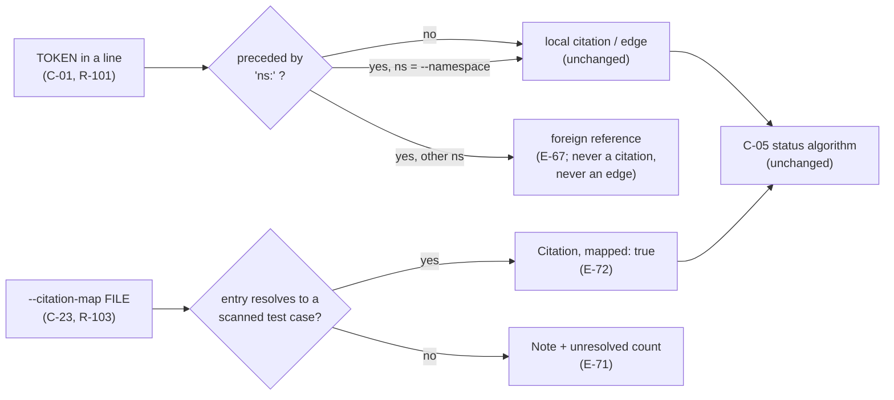

# Proposal — v1.23: namespaced ids (`platform:C-03`) and a citation map for retrofitting existing test suites

> - **Status:** proposal, 2026-10-27; for `spec-writing` to turn into `SPEC.md` v1.23 rows after the
>   requester settles D-51, D-52, D-53, D-54 and D-55 below. Base is `SPEC.md` v1.22 (the
>   JavaScript/TypeScript adapter, R-104, which lands first and takes R-104, E-74..E-76, T-113..T-116, D-56). No other proposal is pending: every earlier `PROPOSAL_v1.*` has been folded into the
>   spec, and its draft ids are below the spec's current maxima (R-100, C-21, I-018, K-18, E-66,
>   T-106, D-50), which this proposal numbers past.
> - **Applies to:** `SPEC.md` v1.22 — C-01 (the TOKEN regex and citation rule), C-03 (`Citation`),
>   C-12 (edge extraction from statements), C-07 (a conditional top-level key, as `proof` is for
>   I-018), §5.1 (two new `check` flags), E-09 (containment of the new file), and
>   `src/speccheck/extract.py`, `attribute.py`, `cli.py`, `report.py`. New rows: R-101, R-102,
>   R-103, C-22, C-23, I-019, K-19, E-67..E-73, T-107..T-112. Parts A and B are independent: either
>   can land without the other.
> - **Notation:** unprefixed ids are speccheck's own. A foreign id is written `project:ID` in inline
>   code — the convention `SPEC.md`'s revision history, `skills/spec-writing/SKILL.md` and every
>   earlier proposal already use (`mdv:C-17`, `hello:R-09`); this proposal makes the tool agree
>   with it.
> - **Evidence:** (1) a user report, `letter_from_johnathan.md`, Message 1 (2026-10-14), a
>   five-repository, ~57,000-line medical-device program: *"Two specs in one program cannot cite
>   each other's IDs without colliding"* and *"Retrofitting an existing codebase needed our own
>   citation map and injector"* (their engineers own the repositories, so the citations were
>   injected as comments into a throwaway copy and the patch handed to each owner). About 1,100
>   ids went through the gate that way. (2) A reproduction on 2026-10-27 of the collision, below.
>   The report is the only external evidence; the reproduction is mine, and the token behaviour in
>   (2) is current code, not a claim.

## 1. The problem

**A. A foreign id is read as a local citation.** `ID_RE` (`extract.py:19`) requires only that the
character before the token is not alphanumeric, so the `:` in `platform:C-03` does not stop it.
Reproduced: a project whose `SPEC.md` declares `C-03` and whose only test is

```python
def test_platform_side():
    """platform:C-03 is the other project's contract."""
    assert True
```

with a passing `junit.xml` runs to `speccheck: CONFORMING - 1/1 passing (100.0%)`. The local `C-03`
is `PASSING` on the strength of a docstring that names a *different project's* `C-03`. This is not
a style problem; it is the false-green the tool exists to prevent, and it is silent. The mirror case is a hard failure: a foreign `platform:C-99` that the local spec does not declare is a dangling citation (R-07), which `--strict` turns into exit `1` (R-15). The same
regex runs over statements, so a revision-history sentence naming `mdv:C-17` adds a `depends_on`
edge to the local `C-17` whenever the declaring row contains it (C-12).

The convention the tool already documents for *writing* foreign ids — `project:ID` in code font —
is the notation the tool does not *read*. A scan of this repository on 2026-10-27 finds colon-prefixed ids only in prose — proposals, the
revision-history rows of `SPEC.md` (not declarations), `SPEC_BUILD_REPORT.md` and the
`spec-writing` skill — and none in `src/`, `tests/`, `tools/`, `fixtures/` or any declared
statement, so treating them as foreign moves nothing here. That is the evidence for the default in D-51, not a guarantee about other projects.

**B. A suite that already exists cannot be cited without editing it.** Every status rests on a
literal token in a test file (F-013, C-01). A team that owns the specs but not the repositories
(Johnathan's case: engineers own the code) has two choices today: edit the tests, or inject
comments into a copy and ship a patch. The second works — it is what they did, at ~1,100 ids — but
the injector, the map and the throwaway copy are all outside the tool, so nothing in the report
says *which* citations were never in the code. A reader of that report sees `PASSING` and cannot
tell a citation an engineer wrote from one a script wrote.

**What did not hold up.** My first reading of the letter's namespace request was "an optional
prefix on every id" (`platform:C-03` as the *declared* form). That is wrong for this tool: a spec
declares its own ids in bare form, and a prefix there would break E-02 duplicate detection and the
`spec2pdf` cross-reference pass. The requirement is on the *citing* side only — recognise a token
as someone else's, and optionally resolve it when the checked spec *is* that someone. Part A is
scoped to that.

## 2. The change

Part A is cheap and closes a silent false-green, so it is the part worth doing even if Part B is
rejected. Part B is larger and weakens a guarantee on purpose; it is opt-in.



*Figure: Part A routes every token; Part B adds a second source of `Citation`s. Neither touches C-05.*

**Part A — namespaced tokens (R-101, R-102, C-22).**

- A token immediately preceded by `<ns>:` (no space), where `<ns>` is `[A-Za-z][A-Za-z0-9_-]{0,31}`,
  is a **foreign reference**. It is never a citation of a local id, never a C-12 edge, never a
  dangling citation, and never a Note about an undeclared edge target. The match is lexical, as
  C-01 already is: no semantic judgement.
- `check` gains `--namespace NS` (R-102). Tokens written `NS:ID` are then **local** citations of
  `ID`, so a downstream project's tests can cite `platform:C-03` and the platform spec's run
  (`--namespace platform`) counts them. Bare `ID` tokens stay local (D-52).
- Foreign references found in scanned source and test files are listed in a conditional top-level
  `foreign` array of `{namespace, id, file, line}` (absent when there are none, so a run with no
  foreign token is byte-identical to v1.22, I-019). The Markdown report gains no section; a Note
  `N foreign reference(s) ignored` is emitted once.

**Part B — `--citation-map FILE` (R-103, C-23).**

- A JSON file, resolved inside `--root` (E-09), at most 2 MiB and 100,000 entries (K-19):

  ```json
  {"schema_version": "1.0",
   "citations": [{"id": "R-03", "file": "tests/test_core.py", "test": "test_zero_rate"},
                 {"id": "R-07", "file": "web/src/review.test.ts", "test": ""}]}
  ```

  `test` is the test case's `name` (C-03); `""` means the file-level case.
- Each entry resolves, by exact `(file, test)`, to a `TestCase` produced by the normal scan of
  `--tests`. It becomes a `Citation(kind="test", declared=true)` with a new `mapped: true` field.
  A literal citation of the same `(id, testcase)` wins and the entry adds nothing (E-73).
- Statuses, the judge and `--strict` treat a mapped citation exactly like a literal one: C-05 is
  not modified (I-004). What changes is visibility: the JSON carries `mapped` per `tests[]` entry,
  a conditional top-level `citation_map` `{file, entries, resolved, unresolved}`, and the summary
  line gains the suffix `; citations: N mapped` when `N > 0` (D-54).
- An entry whose `(file, test)` matches no scanned case is **unresolved**: a Note naming the entry
  and the count; with `--strict` it is reported but does not by itself change the exit code (D-55).
  An entry naming an undeclared id is an ordinary dangling citation (R-07).

Proposed rows, drafted for `spec-writing`:

| Family | Draft |
| --- | --- |
| **R-101** | The checker MUST treat a TOKEN immediately preceded by `<ns>:`, where `<ns>` matches `[A-Za-z][A-Za-z0-9_-]{0,31}` and is not the `--namespace` value, as a foreign reference: it MUST NOT yield a citation, a C-12 edge, a dangling citation or an undeclared-target Note (C-22, E-67, E-69). Source: §1 A. |
| **R-102** | `check` MUST accept `--namespace NS` (one value, matching the `<ns>` grammar of R-101); a token written `NS:ID` MUST then be a citation of local `ID`, identically to the bare token, and a bare token MUST remain a local citation (E-68, D-52). Source: §1 A. |
| **R-103** | `check` MUST accept `--citation-map FILE`; each resolving entry MUST yield one `mapped` test citation of its id on the named test case, marked in `speccheck.json` and in the summary line, and MUST NOT change C-05, the judge's eligibility or any exit code on its own (C-23, E-70..E-73, I-019). Source: §1 B. |
| **C-22** | Foreign reference. Grammar: `(?<![A-Za-z0-9])(?P<ns>[A-Za-z][A-Za-z0-9_-]{0,31}):(?P<id>[RCIKET]-[0-9]{1,3})(?![A-Za-z0-9])`, evaluated before the C-01 TOKEN rule on the same line. JSON: `foreign` = array of `{"namespace","id","file","line"}` sorted by `(file, line, namespace, id)`, present only when non-empty and only for files under `--src`/`--tests`; a foreign token in `SPEC.md` is never listed. Not affected by `speccheck:ignore` differently from any other token (R-27). |
| **C-23** | Citation map. `{"schema_version": "1.0", "citations": [{"id","file","test"}...]}`; `id` a bare TOKEN form, `file` a POSIX path relative to `--root`, `test` a string. Unknown top-level keys are ignored; unknown entry keys are an E-72 fault. `Citation` gains `mapped: bool` (default `false`); JSON `tests[]` entries gain `mapped` only when the run has a map. Top-level `citation_map` = `{"file","entries","resolved","unresolved"}`, present only when `--citation-map` was given. |
| **I-019** | A run given neither `--namespace` nor `--citation-map` and whose scanned files and statements contain no `<ns>:`-prefixed token produces `speccheck.json` and `SPEC_CONFORMANCE_REPORT.md` byte-identical to v1.22's (the I-018 pattern). |
| **K-19** | A citation map is at most 2 MiB and 100,000 entries; beyond either, E-72 (exit `3`). |
| **E-67** | A foreign reference in a scanned file → recorded in `foreign`, no citation, one Note `N foreign reference(s) ignored`. |
| **E-68** | `--namespace NS` given and a token `NS:ID` in a scanned file → a local citation of `ID`; not listed in `foreign`. A `--namespace` value that does not match the `<ns>` grammar → exit `2`, `--namespace: invalid namespace`. |
| **E-69** | A foreign reference inside a declared statement or an *Affects* cell → no edge and no Note; the declared id of the same number is unaffected. |
| **E-70** | `--citation-map` unreadable → exit `2`, `--citation-map: <reason>`; outside `--root` → E-09; not JSON, wrong `schema_version`, a missing/ill-typed `citations`, an entry missing a key or carrying an unknown key, or over K-19 → exit `3`, `citation-map: <reason>`. No report is written. |
| **E-71** | A map entry whose `(file, test)` matches no scanned `TestCase` → unresolved: one Note per entry `citation-map entry unresolved: <id> <file> <test>`, counted in `citation_map.unresolved`; exit code unaffected (D-55). |
| **E-72** | A map entry that resolves → one `Citation(kind="test", declared=true, mapped=true)`; the summary line gains `; citations: N mapped` (N = resolved entries that added a citation) when N > 0. |
| **E-73** | A map entry whose `(id, testcase)` is already cited literally → no second citation, `mapped` stays `false`, the entry counts as resolved. |
| **T-107** | The §1 A reproduction: a test docstring naming `platform:C-03` against a spec declaring `C-03` leaves `C-03` `UNCITED`, lists the token in `foreign`, and emits the Note; the same project with `--namespace platform` makes `C-03` `PASSING`. (R-101, R-102, E-67, E-68) |
| **T-108** | A declared statement containing `platform:C-03` adds no `depends_on` edge to `C-03` and no Note; a bare `C-03` in the same statement still does. (R-101, E-69) |
| **T-109** | Byte identity: the §9.8 golden fixture and `--self-check` outputs are unchanged. (I-019) |
| **T-110** | A map resolving a Python test case and a file-level case: statuses equal those of the same project with literal citations; `mapped` is `true` per entry; the suffix and `citation_map` counts match; a literal duplicate stays `mapped: false`. (R-103, E-72, E-73) |
| **T-111** | Map faults: unresolved entry (Note, exit unchanged), undeclared id (dangling), malformed JSON, unknown entry key, outside `--root`, unreadable. (E-70, E-71, K-19) |
| **T-112** *(recorded)* | Re-run the 2026-10-27 reproduction and this repository's own `check --strict` before and after: ids, statuses and exit code identical; the measurement records the number of foreign references found (expected 0 in code). (R-101) |

## 3. What it costs

- No new dependency. `extract.py` gains one regex pass; `attribute.py` is untouched except that
  `Citation` gains a defaulted field; `cli.py` gains two flags and one file read.
- Output churn is confined to runs that use the new flags or contain a foreign token (I-019); the
  golden fixtures should not move, and T-109 checks that rather than assuming it.
- **Behaviour change for existing users (Part A):** a token like `team:R-03` that was a local
  citation becomes foreign by default. In this repository that moves nothing (§1 A), but another
  project may have cited that way on purpose. D-51 offers the opt-in alternative.
- Part B **weakens a guarantee deliberately.** F-013 says a citation is a literal token a reader
  can grep. A mapped citation is not in the code; the map is. The mitigation is labelling (per-test
  `mapped`, the summary suffix), not prevention. A map can also go stale: a renamed test turns its
  entry unresolved, which is a Note, not a failure (D-55). Nothing here is model-dependent; every
  part is deterministic and has a mechanical test.

## 4. Alternatives considered

| Alternative | Why not |
| --- | --- |
| Prefix on declared ids (`platform:C-03` in the spec) | Breaks E-02 duplicate detection and the `spec2pdf` cross-reference pass; the collision is on the citing side only (§1, "what did not hold up"). |
| Fan one run across N specs (`--spec` as a set) | Reopens §0's "one spec per invocation" line, a far larger change; Part A gives cross-project citations without it. |
| Keep injecting comments into a throwaway copy (status quo) | Works, but the injector is outside the tool and the report cannot distinguish injected from written citations. |
| Auto-infer citations from test names (`test_r03_*`) | Contradicts "never infers intent from context" (§0, F-013); a convention, not evidence. |
| CSV map instead of JSON | Smaller, but test names contain commas and brackets (C-04 `join_name`), and every other machine input here is JSON (C-04 is XML; C-21 is JSON). D-53. |

## 5. Decisions for the requester (D-51..D-55, all `confirm`)

| ID | Statement |
| -- | --------- |
| **D-51** | foreign tokens are recognised by default, no flag needed (recommended: the false-green in §1 A is silent, an opt-in would leave it on for everyone who does not know to ask, and this repo's own scan shows no use of the old behaviour) versus recognised only when `--namespace` is given (zero behaviour change for existing runs, but the collision stays live by default). |
| **D-52** | with `--namespace NS`, `NS:ID` is local and a bare `ID` stays local (recommended: no spec has to be rewritten to adopt the flag) versus a bare `ID` becomes foreign once a namespace is declared (stricter, but every existing citation must be rewritten). |
| **D-53** | the citation map is JSON (recommended: matches C-21, handles commas and brackets in test names) versus CSV (hand-editable in a spreadsheet, brittle on names). |
| **D-54** | mapped citations are marked in the per-test JSON and the summary line (recommended: the one cost of Part B is that the citation is not in the code, so the report must say so where it is read) versus marked only in the JSON (quieter summary, easier to miss). |
| **D-55** | an unresolved map entry is a Note and does not change the exit code (recommended: a stale entry lowers that id's status anyway, which `--strict` already gates) versus an unresolved entry fails `--strict` (stricter, but a renamed test in an unrelated repository would break a gate for a reason `--strict` already measures). |

## 6. What the change does not do

- **C-05 is untouched.** No status, verdict or exit rule changes; a mapped citation is a citation.
  The judge sees mapped edges as it sees any other, and its "may only make the news worse" posture
  is the same (I-004).
- It does not make any run multi-spec. `--namespace` names *this* project to the world; nothing
  loads a second spec, and a foreign id is not looked up anywhere (no cross-project dangling
  detection, no cross-project `impact`).
- It does not generate a map. Producing one from a test suite is the caller's job (Johnathan's team
  already has the script); a generator under `tools/` is a candidate for a later proposal.
- Foreign references in `SPEC.md` are ignored, not validated: a typo'd `platfrom:C-03` is silently
  foreign. A cross-project reference check needs a second spec in hand and is out of scope.
- The map's correctness is the caller's. The tool checks that an entry points at a real test case,
  not that the test asserts the requirement; that remains the judge's question.
- The vitest/jest adapter (next piece of work) is independent: a map entry for a `.ts` file
  resolves only once that adapter produces `TestCase`s for it, and until then it is an E-71 Note.
