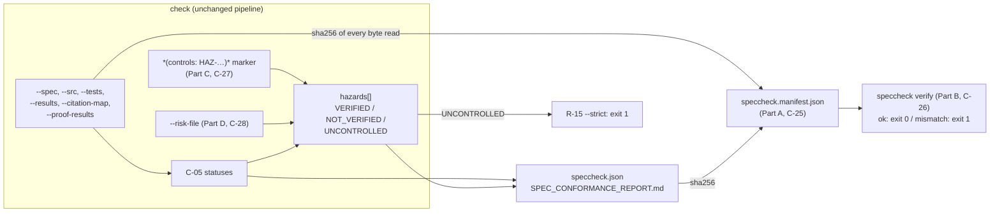

# Proposal — v1.25: a provenance manifest a QMS can file as a record, and hazard-to-control traceability

> - **Status:** proposal, 2026-11-05; D-61..D-65 confirmed on the recommended branches by the
>   requester, same day. Ready for `spec-writing` to turn into `SPEC.md` v1.25 rows. No other proposal is pending (v1.24's was built
>   2026-10-27), so the draft ids (R-106..R-109, C-25..C-28, I-020, I-021, K-20, E-78..E-85,
>   T-122..T-129, D-61..D-65) collide with nothing.
> - **Applies to:** `SPEC.md` v1.24. **Parts A and B:** §5.1 (a `--manifest` flag on `check`, a new
>   `verify` subcommand), I-001 (a third file under `--out`, only with the flag), I-002 (extended to
>   the manifest), C-19 (the help text for the flag, the subcommand and `SOURCE_DATE_EPOCH`).
>   **Parts C and D:** C-01 (a third DECORATION marker after RECORDED), C-07 (a `hazards` key and a
>   per-id `controls` key, both present only when used), C-08 (a `## 10. Hazards` section, present
>   only when used), R-15 (one new `--strict` condition), §5.1's summary line and the T-44 regex.
>   Parts A+B and C+D are independent of each other, and either pair can land alone. B needs A, and D needs C.
> - **Notation:** unprefixed ids are this project's own. A hazard id such as `HAZ-003` belongs to the
>   *user's* ISO 14971 risk management file, never to a `SPEC.md`, and is written bare inside a
>   `*(controls: …)*` marker (Part C).
> - **Evidence:** (1) **The manifest.** These runs were reproduced on 2026-11-05 with speccheck 1.24.0. First,
>   `check --spec SPEC.md --src src --tests tests --results junit.xml --judge mock --strict` was run
>   on a copy of this repository and printed `CONFORMING - 307/307`. `SPEC_CONFORMANCE_REPORT.md`
>   hashed `d51c504c…6b0c` and `speccheck.json` hashed `5a9f30c3…0b1527`. Then a line was appended
>   to `src/speccheck/report.py`, *after* `junit.xml` had been produced, and the run was repeated:
>   **both reports were byte-identical to the first run** (same two hashes). An edit to SPEC.md §0
>   prose left the Markdown report byte-identical as well (`d51c504c…`). `speccheck.json` changed
>   only because 307 ids moved down two lines. The JSON's top-level keys are
>   `schema_version, spec, judge, judge_available, strict, max_unknown, strict_judge_failure, ids,
>   decisions, edges, dangling, stale, unattributed_results, notes, metrics, exit_code`. None of
>   them identifies the tool version or the bytes of any input, and C-07 forbids both ("No
>   timestamps, hostnames, absolute paths, durations, or version strings other than
>   schema_version"). (2) **The risk layer.** `letter_from_johnathan.md`, "What we had to adapt",
>   bullet 1, from a team building software as a medical device under the QMSR (ISO 13485 clause
>   7.3) with about 1,100 ids in five repositories: *"a control row and a verifying test for every
>   hazard family in our risk file"*, which they built by hand on top of the tool. (3) **The
>   requirement.** `docs/plans/ISO13485_READINESS_PLAN.md` §3.2 and §3.3.

## 1. The problem

**A. A conformance report cannot say what it was computed from.** ISO 13485 clause 4.2.5 makes the report a
quality record, and clause 7.3.6 makes it design-verification evidence. A record that is
identical for two different code bases does not identify the code it verified. The evidence line
shows this happening: code was edited after the test run, and the run over the edited tree
produced the same two files, hash for hash. The Markdown report, which is the file a reviewer
reads and signs, came out the same after an edit to the specification too. No field ties a report
to the spec bytes, the source bytes, the results file or the tool version that produced it.

That was a deliberate choice. R-16/I-002 (byte-identical output from byte-identical inputs) is
why the reports carry no version or timestamp, and it is the property that makes the tool cheap
to validate (ISO 13485 clause 4.1.6). The fix must not give it up. What is missing is a *separate*
record that binds the reports to their inputs, and a way to check that binding later. Today an
auditor holding the report and the repository at some commit cannot tell mechanically whether the
report belongs to that commit.

A plausible narrower fix was checked and rejected: put the git commit in the report. It fails the
evidence case, because the edit in (1) was an uncommitted working-tree change, so `HEAD` was the
same in both runs. It would also make the reports depend on `.git`, which `check` never reads
today. Hashing the bytes speccheck actually read catches the case. The commit id does not.

**B. Nothing traces a hazard to the requirement that controls it.** IEC 62304 §5.1.1/§7 and
ISO 14971 §7 require that every risk control measure implemented in software is verified, and
that this can be shown. The team in evidence (2) needed exactly that and built it themselves: a
control row per hazard family and a verifying test per control. speccheck already carries half of
the chain, requirement → test → PASSING. It cannot carry the other half, because:

- C-01's FAMILY grammar is closed at `R|C|I|K|E|T`, so a hazard cannot be declared.
- C-22's FOREIGN grammar accepts only a `[RCIKET]-[0-9]{1,3}` id after the namespace, so
  `risk:HAZ-003` is not even recognized as a foreign reference. Its `HAZ-003` is plain text.
- No input lists the hazards allocated to the software, so a hazard with *no* control row cannot
  be reported, and that omission is the most serious one.

One limit on (2): it is one team's account, and their specs were not available to read. What it
supports is the *shape* of the need (hazard → control row → verifying test). It does not support
any particular syntax. The syntax below was chosen to fit C-01's existing RECORDED marker, not
copied from theirs.

## 2. The change

Four parts, cheapest first. A and C each stand alone. B builds on A, and D builds on C.

*Figure: Parts A and B (bottom) bind the reports to their inputs. Parts C and D (top) add a hazard
roll-up computed from statuses that already exist.*

**Part A — `check --manifest`.** With the flag, `check` writes a third file,
`speccheck.manifest.json`, under `--out`. It records the tool version, the effective options, and
the SHA-256 and byte length of every file the run read: the spec, every scanned `--src`/`--tests`/
`--proof` file, `--results`, `--citation-map`, `--proof-results` and `--risk-file`. It also
records one `tree_sha256` over that list, and the SHA-256 of the two reports it wrote. The
manifest is deterministic, like the reports: under `none`/`mock`, identical inputs and environment
give an identical manifest. A time appears only when `SOURCE_DATE_EPOCH` is set (D-62). Without
the flag nothing changes, and the reports never change either way.

**Part B — `speccheck verify`.** `verify --manifest FILE [--root DIR]` re-reads every file the
manifest names, the two reports included, and recomputes each hash. It prints `verify: ok`
(exit `0`) or names each mismatched or missing file (exit `1`). It writes nothing. On the evidence
case it would have named `src/speccheck/report.py`.

**Part C — the `*(controls: …)*` marker.** A declaring row or heading of an R/C/I/K/E id may carry
`*(controls: HAZ-003, HAZ-007)*` in its DECORATION, the place a T id carries `*(recorded)*`. The
marker names the hazards that the id is a risk control for. It changes no status. It adds a
roll-up: a hazard is `VERIFIED` when it has at least one non-retired control and every non-retired
control is `PASSING`, and `NOT_VERIFIED` otherwise. The roll-up appears in the JSON, in a Markdown
section and as a summary-line suffix, and only when at least one marker exists.

**Part D — `--risk-file FILE`.** A JSON list of the hazards whose control is allocated to this
software. Each listed hazard that no non-retired id controls is `UNCONTROLLED`. Under `--strict`
that exits `1` (D-64). Without `--strict`, R-105's `UNPROVEN` already follows. A marker naming a
hazard the file does not list is a Note.

Proposed rows, drafted for `spec-writing`:

| Family | Draft |
| -- | --------- |
| **R-106** | `check` MUST accept a boolean `--manifest` flag. With it, after both reports are written, `check` MUST write `speccheck.manifest.json` under `--out` per C-25, recording the SHA-256 and byte length of every file the run read and of both reports, and MUST NOT change either report's bytes. Without it, no manifest is written and the run is byte-identical to v1.24 (I-021). Source: §1 A, evidence (1). |
| **R-107** | `speccheck verify --manifest FILE [--root DIR] [--verbose [LEVEL]]` MUST re-read, relative to `--root`, every file a C-25 manifest names, recompute each SHA-256, and report per C-26: exit `0` when every file is present with its recorded hash and length, exit `1` when any file is missing or differs, exit `2`/`3` on usage or manifest faults (E-82, E-83). It MUST NOT write any file and MUST NOT open a network connection. Source: §1 A. |
| **R-108** | A declaring row or heading of an R, C, I, K or E id MAY carry the CONTROLS marker (C-27). The checker MUST record each named hazard id on that id (C-07 `controls`) and MUST compute, per hazard, a status of `VERIFIED`, `NOT_VERIFIED` or `UNCONTROLLED` from the C-05 statuses of its controls (C-27). The marker MUST NOT change any id's status, any edge, the judge's eligibility or any metric in `metrics`. Source: §1 B, evidence (2). |
| **R-109** | `check` and `explain` MUST accept `--risk-file FILE` (C-28). Every hazard it lists that no non-retired declared id controls MUST have status `UNCONTROLLED` (E-81), and with `--strict` any `UNCONTROLLED` hazard MUST cause exit `1` (R-15, amended). A CONTROLS marker naming a hazard the file does not list MUST yield a Note (E-79) and MUST NOT affect the exit code. Source: §1 B. |
| **R-15** *(amended)* | With `--strict`, any in-scope ID whose status is not `PASSING`, any dangling citation, any stale citation, **and any hazard whose status is `UNCONTROLLED` (C-27, v1.25)** MUST cause exit `1`. Status (C-05) and hazard status (C-27) are the only inputs to this rule; individual judge verdicts are not consulted again (F-003). *(R-105 follows unchanged: an `UNCONTROLLED` hazard on a non-strict exit-`0` run prints `UNPROVEN`.)* |
| **C-25** | **The provenance manifest** (`speccheck.manifest.json`, `manifest_version` `"1.0"`). One JSON object with keys in exactly this order: `manifest_version`; `tool` = `{"name": "speccheck", "version": "<__version__>"}`; `options` = `{"judge", "strict", "max_unknown", "namespace", "judge_model", "judge_prompt_sha256"}` (`namespace` null without the flag; `judge_model` the `SPECCHECK_JUDGE_MODEL` value verbatim and `judge_prompt_sha256` as in C-07, both null unless `--judge llm`); `inputs` = a list of `{"path", "role", "sha256", "bytes"}`, one per file read, `role` one of `spec`, `src`, `tests`, `proof`, `results`, `citation_map`, `proof_results`, `risk_file`, sorted by (`path`, `role`), with a file read under two roles listed once per role, and a scanned file that K-02/E-10 or E-29 skipped still listed with the hash of its full bytes (a skipped file changes the report through its Note, so its bytes are part of what the report was computed from); `tree_sha256`; `reports` = `[{"path", "sha256", "bytes"}]` for `SPEC_CONFORMANCE_REPORT.md` then `speccheck.json`; `generated_at`, present only when `SOURCE_DATE_EPOCH` is set (D-62). `path` is `--root`-relative with `/` separators (R-20). Hashes are of the raw bytes read, before C-01's CRLF normalization, so a CRLF twin has the same reports and a different manifest. `sha256` is 64 lower-case hex characters. `tree_sha256` is the SHA-256 of the UTF-8 text formed by one line `<sha256>  <path>\n` (two spaces, the `shasum -a 256` format) per *distinct* path in `inputs`, in code-point order of `path`, so that `shasum -a 256 <files> \| sort -k2 \| shasum -a 256` reproduces it. `generated_at` is `SOURCE_DATE_EPOCH` as RFC 3339 UTC (`2026-11-05T00:00:00Z`). A value that is not a non-negative integer is E-85. The JSON is serialized like `speccheck.json` (C-07: two-space indent, `\n`, trailing newline). |
| **C-26** | **`verify` stdout.** One line per failing file, in manifest order (`inputs` then `reports`): `verify: missing <path>` or `verify: mismatch <path>` (hash or length differs), then the last line `verify: FAILED - <k> of <N> files differ` (exit `1`). On success, the single line `verify: ok - <N> files match, tree <first 12 hex of tree_sha256>` (exit `0`). `<N>` counts distinct paths in `inputs` plus the two reports. Report paths resolve relative to `--root`, exactly like inputs. `verify` re-hashes. It does not re-run `check` (D-65). |
| **C-27** | **The CONTROLS marker and the hazard roll-up.** `CONTROLS := "*(controls:" WS? HAZID ("," WS? HAZID)* WS? ")*"` with `HAZID := [A-Za-z0-9][A-Za-z0-9_.-]{0,63}`. In a row it is a token of the DECORATION (C-01 (a)). In a heading it is the token after the ID token, or after the RECORDED marker, and is removed from the title just as RECORDED is. At most one CONTROLS marker counts per declaration. Hazard ids are compared case-sensitively, de-duplicated, and sorted by code point. On a T id the marker is ignored with E-78. A malformed marker is E-80. **Status per hazard *h***, with CTRL(*h*) the non-retired declared ids whose marker names *h*: `UNCONTROLLED` if CTRL(*h*) is empty; else `VERIFIED` if every id in CTRL(*h*) is `PASSING` (a `WEAKLY_PASSING` control is not `PASSING`); else `NOT_VERIFIED`. **JSON:** each id record gains `controls` = the sorted hazard list, after `recorded`, only on ids that carry a marker. The top-level key `hazards`, after `edges`, is `[{"id", "title", "controls", "status"}]` sorted by `id`: `title` comes from the risk file or is null, and `controls` holds the CTRL(*h*) ids in C-07 order. The key is present only when at least one marker or a `--risk-file` exists. **Markdown:** `## 10. Hazards`, after `## 9. Notes`, present only with the key, one row per hazard: `\| Hazard \| Title \| Controls \| Status \|`, controls rendered `R-12 (PASSING)`, semicolon-joined, an em dash when empty. **Summary line:** when the key is present, the line ends `; hazards: <V>/<H> verified`, after the C-23 mapped suffix if any, with `<V>` the `VERIFIED` count and `<H>` the hazard count. T-44's regex gains `(; hazards: \d+/\d+ verified)?` at its end. |
| **C-28** | **The risk file** (`--risk-file FILE`, resolved inside `--root`, E-09; excluded from every scan, as C-23's map is). JSON: `{"hazards": [{"id": HAZID, "title": string}...]}`, with `title` optional and every other key ignored. The file lists exactly the hazards whose risk control is allocated to the software this `SPEC.md` specifies. Hazards controlled elsewhere (hardware, labelling, another item) are left out. Order is free, and the report sorts. Read after the spec is parsed and before C-05. Unreadable → exit `2`. Malformed, not matching the shape, an `id` failing HAZID, or a duplicate `id` → E-84, exit `3`. Over K-20 → E-84. |
| **I-001** *(amended)* | … the two report files of the subcommand that ran, under `--out` (`check`: `speccheck.json`, `SPEC_CONFORMANCE_REPORT.md`, **and `speccheck.manifest.json` when `--manifest` was given, v1.25**; `impact`: `impact.json`, `IMPACT_REPORT.md`; v1.13) … **`verify` creates, modifies and deletes nothing (v1.25).** *(rest unchanged)* |
| **I-020** | **Manifest determinism (v1.25).** I-002 extends to `speccheck.manifest.json`: for `--judge none` and `--judge mock`, identical inputs (bytes of every file read, argv, env, `SOURCE_DATE_EPOCH` included) produce a byte-identical manifest on any OS. Its `reports` hashes equal the SHA-256 of the two files as written by the same run. |
| **I-021** | **Inertness (v1.25).** A `check` run given none of `--manifest`, `--risk-file`, over a spec with no CONTROLS marker, writes `speccheck.json` and `SPEC_CONFORMANCE_REPORT.md` byte-identical to a v1.24 run on the same inputs, prints the same summary line, and exits the same. `SOURCE_DATE_EPOCH` is read only with `--manifest`. |
| **K-20** | **Risk-file size (v1.25).** A risk file is at most 2 MiB, the K-02 cap. Over it, E-84 (exit `3`) before any hazard is read. A HAZID is at most 64 characters (C-27), so a marker or entry with a longer one is malformed (E-80, E-84). |
| **E-78** | A CONTROLS marker on a T id. The id is declared normally with no `controls`. One Note: `controls marker ignored on <ID>: not an R/C/I/K/E id`. (R-108) |
| **E-79** | With `--risk-file`, a CONTROLS marker names a hazard the file does not list. The hazard still appears in `hazards` (`title` null) with its computed status. One Note per run: `<N> hazard(s) not in the risk file: <HAZ>, …` (first three in code-point order, then ` and <N-3> more`). No exit-code effect. (R-109) |
| **E-80** | A DECORATION or heading token that begins `*(controls:` but does not match C-27 (an empty list, a bad HAZID, a missing `)*`). The id is declared normally with no `controls`. One Note: `malformed controls marker on <ID>`. (R-108) |
| **E-81** | With `--risk-file`, a listed hazard has no non-retired control, either because no marker names it or because every id naming it is retired. Status `UNCONTROLLED`. With `--strict`: exit `1` (R-15). Without: R-105's `UNPROVEN` when the exit is `0`. One Note: `<N> uncontrolled hazard(s): <HAZ>, …` (as E-79). Without `--risk-file` no hazard can be `UNCONTROLLED` except through retirement, and that case is reported the same way. (R-109) |
| **E-82** | `verify` with the `--manifest` path missing, unreadable, or outside `--root` (E-09). Exit `2`, message `verify: --manifest <reason>`. |
| **E-83** | `verify` on a manifest that is not JSON, has a `manifest_version` other than `"1.0"`, or lacks any C-25 key. Exit `3`, message `verify: malformed manifest: <reason>`. A path in it that resolves outside `--root` is also E-83 (a manifest cannot direct a read outside the tree). |
| **E-84** | `--risk-file` malformed per C-28, a duplicate hazard id, or over K-20. Exit `3`, message `--risk-file: <reason>`, before C-05 runs. |
| **E-85** | `--manifest` given and `SOURCE_DATE_EPOCH` set to something other than a non-negative decimal integer. Exit `2`, message `SOURCE_DATE_EPOCH: not a non-negative integer: <value>`, before any read (K-18). |
| **T-122** | On the §9.8 golden fixture, `check --judge mock --manifest` writes a manifest whose keys and order match C-25. Every `inputs[].sha256`/`bytes` equals `hashlib.sha256`/`len` of the file on disk. `tree_sha256` equals the value recomputed from the `shasum` line format. `reports[]` hashes equal the two files written. `tool.version` equals `__version__`. The two reports are byte-identical to the same run without `--manifest`. (R-106, C-25, I-021) |
| **T-123** | Two `--manifest` runs over identical inputs give byte-identical manifests. With `SOURCE_DATE_EPOCH=1793836800` the manifest carries `generated_at` `2026-11-05T00:00:00Z`, and without the variable the key is absent. `SOURCE_DATE_EPOCH=abc` exits `2` per E-85. A CRLF twin of the spec gives identical reports and a different `inputs` hash for `SPEC.md`. (I-020, C-25, E-85) |
| **T-124** | `verify` on an untouched tree prints `verify: ok - …` and exits `0`. After one byte of a scanned test file changes it prints `verify: mismatch <that path>` and `verify: FAILED - 1 of <N> files differ`, exiting `1`. After a report is deleted it prints `verify: missing <path>`. A non-JSON manifest exits `3`. A manifest entry `../x` exits `3`. No file under `--root` changes (hash comparison). (R-107, C-26, E-82, E-83, I-001) |
| **T-125** | The §1 A reproduction, as a test: on a copy of the golden fixture, a run with `--manifest` is followed by a one-line append to a `--src` file. A second `check` run gives byte-identical reports, as in v1.24, and `verify` against the *first* manifest exits `1` naming that file. (R-106, R-107) |
| **T-126** | A fixture with CONTROLS markers. `R-01 *(controls: HAZ-2, HAZ-1)*` (PASSING) and `C-01 *(controls: HAZ-2)*` (FAILING) give `HAZ-1` `VERIFIED` and `HAZ-2` `NOT_VERIFIED`. A hazard controlled only by a retired id is `UNCONTROLLED`. A WEAKLY_PASSING control (mock judge) makes its hazard `NOT_VERIFIED`. `controls` appears only on the marked ids, sorted. The marker on `T-01` gives E-78's Note, and `*(controls: )*` gives E-80's. The heading form `### C-02 *(controls: HAZ-3)* Title` yields title `Title`. No id status, metric or edge differs from the same fixture without markers. (R-108, C-27, E-78, E-80) |
| **T-127** | With `--risk-file` listing `HAZ-1`, `HAZ-2`, `HAZ-9`: `HAZ-9` is `UNCONTROLLED` and named in E-81's Note. `--strict` exits `1` even though every id is PASSING. Without `--strict` the run exits `0` and prints `UNPROVEN`. A marker naming `HAZ-7` gives E-79's Note and no exit change. A duplicate id, a bad HAZID or a 2 MiB + 1 byte file exits `3` (E-84). The file is not scanned for citations. (R-109, R-15, R-105, C-28, E-79, E-81, E-84, K-20) |
| **T-128** | I-021: on the §9.8 golden fixture and on every fixture of T-109, a v1.25 `check` with none of the new flags or markers reproduces the committed v1.24 goldens byte for byte. (I-021) |
| **T-129** | The summary line with hazards present ends `; hazards: 1/2 verified` and matches the extended T-44 regex, after `; citations: <M> mapped` when both apply. `## 10. Hazards` renders per C-27 and is absent without the key. (C-27, §5.1) |

## 3. What it costs

- **No new dependency.** `hashlib` is already a kernel dependency (§10). No network access: `verify`
  is as offline as `check --judge none`.
- **No golden churn**, by construction (I-021, T-128). Every new key, section, suffix and file
  appears only when asked for. `schema_version` stays `"1.5"` for the same reason v1.23's
  `citation_map` key did not bump it: an additive key absent by default.
- **Surface growth.** One flag on `check` (`--manifest`), one flag on `check`/`explain`
  (`--risk-file`), one subcommand (`verify`), one environment variable (`SOURCE_DATE_EPOCH`), a third
  DECORATION marker, and their C-19 help text. `explain` shows a `controls:` line only when an id
  carries the marker, which is one C-18 line, drafted when C-18 is amended.
- **Hashing time.** Every read file is already read whole. One extra SHA-256 pass over the same
  bytes costs nothing measurable at K-02's cap.
- **Everything here is deterministic.** No part depends on a model. Under `--judge llm` the
  manifest records the model id and the prompt hash, but the reports it hashes still carry
  non-deterministic verdicts, so `verify` proves *which* report was produced and nothing about
  whether a re-run would reproduce it (§6).
- **Worth doing alone:** Parts A+B. They answer the clause 4.2.5 record question for every user,
  regulated or not, and touch nothing but a new file. Parts C+D are only useful to users who
  keep a risk file.

## 4. Alternatives considered

| Alternative | Why not |
| --- | --- |
| Put the tool version and input hashes *into* `speccheck.json` | It breaks R-16/I-002's "no version strings" rule, and every golden would change on every release. The reports would stop being comparable across tool versions, and that comparability is what makes a re-run check work. A separate file keeps both properties. |
| Record the git commit (`HEAD`) instead of file hashes | It fails the evidence case: the edit was uncommitted, so `HEAD` was the same in both runs (§1 A). It also adds a `.git` read and a VCS dependency to a tool that reads only named files. A user can still put the commit in their record next to `tree_sha256`. |
| A wall-clock timestamp and an `--operator NAME` in the manifest | It breaks I-002 for the manifest, and an operator name the tool cannot authenticate is not a Part 11 attribution. Signing and attribution belong to the eQMS or a signed commit of the manifest. `SOURCE_DATE_EPOCH` lets a pipeline that wants a time supply one deterministically (D-62). |
| `verify --recompute`: re-run `check` from the recorded options and compare report bytes | Stronger, and possible under `none`/`mock`. But it needs the manifest to carry every path flag in a re-runnable form, and it duplicates what an auditor already gets by running the recorded `check` and then `verify`. Kept as D-65's alternative for a later version. |
| A hazard family `H-nn` in C-01's FAMILY grammar | It changes `by_family` (T-34 requires exactly six keys), every golden, C-05's family rules and the FOREIGN grammar. It also forces risk-file ids into speccheck's `X-nnn` shape, and real risk files use `HAZ-003`, `H12`, `RC-4.2`. A hazard is not an obligation speccheck verifies. It is a label on obligations that speccheck does verify. (D-63) |
| Widen C-22's FOREIGN id grammar so `risk:HAZ-003` in a statement is recognized | A foreign reference yields *no* edge and *no* Note by design (R-101, E-69), so the binding would be dropped by the very rule built to ignore other projects' ids. Widening the id grammar would also start matching ordinary prose such as `ISO:13485` and `note:A-1`, breaking I-019. |
| Read hazard links from §12 *Affects* cells or a new spec section | §12 records decisions, not controls, and a new section would be a second declaration grammar. The marker sits on the row that *is* the control, the way RECORDED sits on the row that is recorded, and C-01 already parses that position. |
| A per-requirement IEC 62304 safety class (`*(class: C)*`) that tightens `--strict` | Covered in §6. `--strict` already requires every in-scope id to be `PASSING` with no dangling or stale citation, so there is no stricter status rule left to add. Class C's extra obligations (detailed design, unit-level verification, SOUP) are process obligations the tool cannot observe. |

## 5. Decisions for the requester (D-61..D-65, all `confirmed` 2026-11-05 on the recommended branch)

| ID | Statement |
| -- | --------- |
| **D-61** | The manifest is opt-in behind `--manifest` (recommended: I-001, I-002 and every golden stay untouched for users who do not file records, and I-021 can be stated exactly) versus always written (one less flag to forget in a regulated pipeline, but a third file appears in every `--out`, and T-38's "only the two report files are created" is rewritten for all users). |
| **D-62** | The manifest carries no operator and no wall-clock time, and carries `generated_at` only from `SOURCE_DATE_EPOCH` (recommended: the manifest stays deterministic per I-020, and attribution and signature stay with the eQMS or a signed commit, where Part 11 can actually be met) versus an `--operator NAME` flag and a wall-clock timestamp (one self-contained file, but neither is authenticated, and the manifest would no longer reproduce). |
| **D-63** | Hazards are bound with a `*(controls: …)*` DECORATION marker on the controlling row (recommended: no new ID family, hazard ids keep the risk file's own shape, and C-01 already parses this position for RECORDED) versus a new `H-nn` declaration family in C-01 (hazards become first-class rows with statuses, at the cost of `by_family`, every golden, and renumbering the user's hazards into speccheck's shape). |
| **D-64** | An `UNCONTROLLED` hazard fails `--strict` (recommended: the risk file lists exactly the hazards allocated to this software, so one with no control row is the gap ISO 14971 §7 asks to close, and making it a Note would let a CONFORMING run hide it) versus a Note only (no new R-15 condition, but a green `--strict` gate with a hazard nobody controls). |
| **D-65** | `verify` re-hashes and does not re-run (recommended: simple and exact, works for `llm` runs too, and an auditor who wants a re-run already has `check` plus `verify`) versus adding `verify --recompute` for `none`/`mock` manifests (proves the reports *follow from* the inputs, not just that they are unchanged, but needs re-runnable argv in C-25 and a temporary `--out`). |

## 6. What the change does not do

- **No status, verdict, metric or existing exit path changes.** C-05 is untouched. The only new
  way to exit `1` is an `UNCONTROLLED` hazard under `--strict`, and only with a CONTROLS marker or
  `--risk-file` present (D-64). "The model may only ever make the news worse" holds as before:
  none of this involves the judge.
- **The manifest does not prove `junit.xml` came from the hashed tree.** It binds the report to
  the results file it read and to the source files it scanned. It cannot know which build
  produced those results, and that is the CI's record. A later proposal could have the test run
  stamp `tree_sha256` into a JUnit `<property>` that `check` compares. That one is deferred,
  because it needs a pytest/Swift/JS hook in every adapter.
- **The manifest covers only what speccheck read.** Code that is executed by the tests but lies
  outside `--src`/`--tests` is not hashed, and neither are the interpreter or dependencies. A
  user who needs the full build pinned records a commit and a lockfile hash beside the manifest.
- **No signature and no Part 11 attribution.** The manifest is a hashable object to sign. It is
  not a signature. Who ran it, who approved it, and when are the eQMS's job (D-62).
- **No IEC 62304 safety class.** It was dropped after checking R-15 (§4, last row). Nothing in this
  proposal stops a later one from adding class-dependent rules, for example "a class C control
  must have a DECLARED (C-14), not mapped (C-23), citation". That rule has no evidence behind it
  yet. Collect some, such as a run where a mapped citation was the only evidence for a control,
  before proposing it.
- **Hazards are labels, not obligations.** speccheck still verifies requirements. A `VERIFIED`
  hazard means every software control named for it passed its tests. It does not mean the risk
  is acceptable. Risk estimation and evaluation stay in the risk management file.
- **`impact` does not walk hazards.** A change to `R-12` does not yet list `HAZ-003` as impacted.
  This is the natural next step once C-27 exists, and it is deferred to keep C-13 untouched in
  this version.
- **It does not validate speccheck.** It gives a validation (ISO 13485 clause 4.1.6) two more
  things to test. The intended-use statement, the tool risk assessment and the IQ/OQ protocol
  are documents, tracked in `docs/plans/ISO13485_READINESS_PLAN.md` §3.1.
