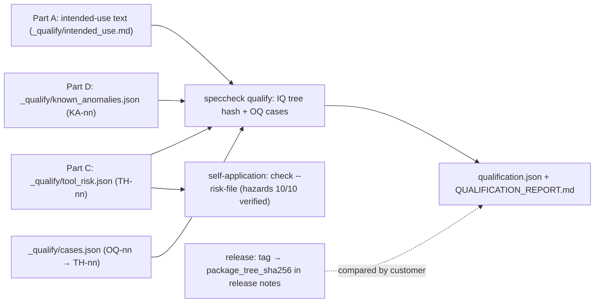

# Proposal — v1.26: a validation pack a manufacturer can run, file and sign (intended use, `speccheck qualify`, a machine-checked tool risk file, known anomalies, change control)

> - **Status:** proposal, 2026-11-05; D-66..D-71 confirmed on the recommended branches by the
>   requester, same day, and folded into `SPEC.md` v1.26 the same day. No other proposal is pending (v1.25's was built
>   and released 2026-11-05). `PROPOSAL_obligation_census.md` carries no `SPEC.md` version and
>   reserves no ids. So the draft ids (R-110..R-115, C-29..C-31, I-022, I-023, E-86..E-88,
>   T-130..T-137, D-66..D-71) collide with nothing.
> - **Applies to:** `SPEC.md` v1.25.
>   - **Part A:** §0 (an *Intended use* paragraph).
>   - **Part B:** §5.1 (a fifth subcommand, `qualify`), C-19 (its help screen), E-85 (extended to
>     `qualify`), §10 (the packaged `_qualify/` data).
>   - **Part C:** no kernel change. It adds CONTROLS markers (v1.25 C-27) on existing rows of this
>     repository's own `SPEC.md`, and one risk file (C-28).
>   - **Part D:** documents and a `tools/` script only, plus one packaged data file that Part B
>     renders.
>   - Dependencies: A and C stand alone. B renders A's statement, C's hazards and D's anomalies, but
>     it degrades to omitting a section if any of the three is rejected. D's change-control rule
>     needs C.
> - **Notation:**
>   - Unprefixed `R/C/I/K/E/T/D` ids are this project's own.
>   - `TH-nn` (tool hazard), `OQ-nn` (operational-qualification case) and `KA-nn` (known anomaly)
>     are labels in data files this proposal adds, not `SPEC.md` families. None of them matches the
>     C-01 TOKEN grammar, so none is ever a citation.
> - **Evidence:** everything below was reproduced on 2026-11-05 with speccheck 1.25.0 at `a009c83`,
>   and with the copy `install.sh` installed on this machine. That copy was 1.24.0 when this proposal
>   was drafted, and was re-installed as 1.25.0 the same day; both installs were measured.
>   - **(1) The installed copy can prove one thing about itself.**
>     - The installed 1.25.0 wheel's `RECORD` lists 46 hashed files (1.24.0: 45), 16 of them under
>       `speccheck/_selfcheck/`. All 46 match disk.
>     - Its only `Requires-Dist` entries belong to the `dev` and `llm` extras, so the validated
>       function has no runtime dependency outside the standard library.
>     - None of the 19 `tests/test_*.py` files (192 `def test_` functions; 213 cases with
>       parametrisation) ships.
>     - So the only check a customer can run after installing is `--self-check`. That is one
>       fixture and one pinned `check` argv. Run from the installed 1.25.0 in an empty directory, it
>       printed `self-check: ok` in 0.06 s. It never exercises `--manifest`,
>       `verify`, `--risk-file`, the Swift or JS/TS adapters, or `impact`.
>   - **(2) The installed files are reproducible from a tag.**
>     - Take the installed `speccheck/` package files from `RECORD` and hash them in C-25's
>       `shasum` line format. For two releases this equals the same computation over the tag:
>
>       | Release | Files | Installed package tree | `git archive <tag> src/speccheck` |
>       | --- | --- | --- | --- |
>       | 1.24.0 | 35 | `e6dce81cc30b…12f9` | `e6dce81cc30b…12f9` |
>       | 1.25.0 | 36 (adds `manifest.py`) | `b76021806389…1103` | `b76021806389…1103` |
>
>     - So a per-release package tree hash, computed from the tag alone, identifies an installation
>       exactly. Today no release publishes one: the 1.24.0 and 1.25.0 releases have no assets and
>       no hash.
>     - The install records only where it came from, not what: both installs' `direct_url.json` is
>       `{"url": "file:///Users/rioffe/projects/speccheck"}`, a checkout path with no tag or
>       commit. Only the tree hash ties the installed files to a release.
>     - Until the re-install, nothing told this machine's operator that the installed 1.24.0 was one
>       release behind.
>   - **(3) The controls the readiness plan names have moved.**
>     - `speccheck impact --against` the v1.18.0 `SPEC.md` reports 134 changed ids. Among them are
>       C-01, C-03, C-04 and R-15: every control row `ISO13485_READINESS_PLAN.md` §3.1 lists for a
>       false `PASSING` except C-05.
>     - v1.18 is the version `proof/` models (its README says so). C-05's section text is unchanged
>       since v1.18 (both digests `462007f6b41e`). But R-15 gained the `UNCONTROLLED` condition in
>       v1.25, which `proof/`'s `exitOfCheck` does not model.
>     - Against v1.24, the same command reports 43 changed ids, including R-15, C-01, C-03 and C-07.
>     - No document says which of these changes obliges a customer to revalidate.
>   - **(4) Known limitations are scattered.** They live in two release notes' *Not yet* sections and
>     in SPEC.md §0's F-013 paragraph. No list is versioned with the release.
>   - **(5) The requirement.** `docs/plans/ISO13485_READINESS_PLAN.md` §3.1, under ISO 13485 clause
>     4.1.6 (validate QMS software before first use and after changes) and ISO/TR 80002-2.

## 1. The problem

A manufacturer that uses speccheck inside an ISO 13485 QMS must validate it for its intended use
before first use and after every change (clause 4.1.6). An auditor will ask for five things. Today
speccheck gives none of them in a form the manufacturer can file.

**A. No intended use.** SPEC.md §0 says what the tool *is*. It never says which functions a
regulated user may rely on. The deterministic kernel and the LLM judge have very different
validation profiles: the first reproduces byte for byte (I-002), the second depends on a remote
model. But nothing marks one as in scope and the other as not. Without that boundary, a validation
either covers the judge (expensive, and §3.4 of the plan is still open) or covers nothing precisely.

**B. No qualification the customer can run in their own environment.** Installation qualification
(IQ) asks whether the installed tool is the released tool. Operational qualification (OQ) asks
whether it behaves as specified *here*, on this Python and this OS. Evidence (1) shows the installed
wheel can answer neither:

- the acceptance suite stays in the repository;
- `--self-check` covers one fixture;
- nothing compares the installed files to anything published.

Evidence (2) shows the comparison is cheap and exact. The installed package tree hashes to the
digest of the tag it was built from, so a release only has to publish that digest.

**C. The tool risk assessment exists only as four bullet points.** The plan names the hazardous
failure, a *false `PASSING`*, and four causes with a control each. Evidence (3) shows why that is
not enough. Four of the five named controls changed between v1.18 and v1.25, and the one formal
artefact the plan leans on, "the Lean proof of C-05", predates the v1.25 exit condition. A risk
assessment written as prose goes stale silently. But v1.25 shipped exactly the machinery that
cannot go stale: CONTROLS markers on the rows that realise a control, and `--risk-file` to make an
uncontrolled hazard fail `--strict`. speccheck has not applied it to itself.

**D. No known-anomalies list and no change-control rule.** Evidence (4) and (3). A customer cannot
tell from a release whether it touched a validated function, and cannot find in one place what the
tool is known to get wrong.

One mechanism that looked plausible and does **not** hold up: "the Lean proof covers status
computation, so OQ can skip it". `proof/` proves a *model* transcribed from v1.18 code (its README
calls the transcription leg manual). It says nothing about the bytes installed on a customer's
machine. OQ still has to run the installed code. The proof lowers the probability of an algorithmic
error, not the need to observe the installed tool.

## 2. The change

Four parts, cheapest first. A and C are mostly text; B is the one new code path; D is documents
plus a script.

**Part A — the intended use, in SPEC.md §0.** A new paragraph and one requirement:

- The *validated function* is `check`, `verify` and `impact`, each with `--judge none` or
  `--judge mock`, and `--self-check` / `qualify`.
- `--judge llm`, `--jev-pre-triage` and `explain` are outside validated use. They are advisory
  (I-004, I-015, I-016) and may be used, but their output is not verification evidence for the QMS.
- The statement is packaged as text, so `qualify` (Part B) prints it verbatim in every qualification
  record.

**Part B — `speccheck qualify`, IQ and OQ in one command.**

```text
speccheck qualify [--out DIR] [--verbose [LEVEL]]
```

It reads only its own installed package, with no project inputs. In-process, under the socket
guard, it does the following:

1. **IQ.** It computes the *package tree hash*: SHA-256 over the `speccheck/` files the installed
   distribution's `RECORD` lists (`*.pyc` and `__pycache__/` excluded), in C-25's `shasum` line
   format. It also checks every `RECORD` entry's own hash against disk. It records:
   - the distribution version, the `direct_url.json` source (if any), the CPython version and
     implementation, `platform.system()`/`platform.machine()`;
   - the installed version of every dependency `Requires-Dist` names (extras marked *not
     installed* when absent).
2. **OQ.** It runs each case of the packaged catalog `speccheck/_qualify/cases.json` (C-30) in a
   fresh temporary copy of its packaged fixture. It compares the named output files byte for byte
   to the packaged goldens, and the exit code and stdout line to the expected ones. Each case names
   the tool hazards (Part C) it challenges. The initial catalog:

   | Case | What it runs | Challenges |
   | --- | --- | --- |
   | OQ-01 | the `--self-check` argv on the §9.8 fixture (every status, a retired id, a dangling and a stale citation) | TH-01, TH-04, TH-05, TH-06, TH-07, TH-09 |
   | OQ-02 | `check --judge mock --strict` on the Swift fixture | TH-02, TH-04 |
   | OQ-03 | `check --manifest` on the §9.8 fixture, `verify` (exit `0`), one byte appended to a `src` file, `verify` again (exit `1`, the `mismatch` line) | TH-03, TH-08 |
   | OQ-04 | `check --strict --risk-file` on a marked copy of the §9.8 fixture: one hazard each `VERIFIED`, `NOT_VERIFIED`, `UNCONTROLLED`; exit `1` | TH-06 |
   | OQ-05 | `impact --changed K-02` on the §9.8 fixture | TH-10 |

3. **Record.** It writes `qualification.json` and `QUALIFICATION_REPORT.md` under `--out` (default
   `.`) in one all-or-nothing write (§3.1 step 5, as `check` does). The record carries:
   - the intended use (Part A);
   - the IQ facts and the package tree hash;
   - each case's result;
   - the tool hazards and the cases that challenge each (Part C);
   - this version's known anomalies (Part D);
   - a verdict, `QUALIFIED` or `NOT QUALIFIED`.

   The Markdown ends with an empty signature block (*Executed by / Reviewed by / Date*). Signing it
   is the customer's quality system's job, as the manifest's is (D-62).
4. **Exit and print.** It prints one line, `qualify: QUALIFIED - IQ <n> files, tree <12hex>; OQ
   <k>/<k> cases` (exit `0`), or `qualify: NOT QUALIFIED - …` naming the first failure (exit `1`).

The customer's IQ is then one comparison: the printed tree prefix and the report's full
`package_tree_sha256` against the value the release notes publish for that tag (D-68).

`--self-check` is not changed (I-023). It stays the one-line smoke test, and OQ-01 runs exactly its
argv.



*Figure: how Parts A, C and D feed Part B's record, and how C also gates speccheck's own build.*

**Part C — the tool risk assessment as a risk file speccheck checks on itself.**
`src/speccheck/_qualify/tool_risk.json` is a v1.25 C-28 risk file listing ten tool hazards. The
rows of this repository's `SPEC.md` that realise each control carry the CONTROLS marker. The
self-application gate (`SPEC_BUILD_REPORT.md` Phase A and B) adds `--risk-file
src/speccheck/_qualify/tool_risk.json`. From then on, a control row retired, renamed or failing
turns its hazard `NOT_VERIFIED` or `UNCONTROLLED`, and `--strict` fails the build. The draft
mapping, for the requester to review (the controls are existing ids):

| Hazard | Cause of a false `PASSING` (or a missed revalidation) | Controlled by (marker on) | OQ case | Residual, see KA |
| --- | --- | --- | --- | --- |
| TH-01 | a token counted as a citation that realises nothing | R-03, R-04, R-27, C-01, C-03, R-22 | OQ-01 | KA-02 |
| TH-02 | a JUnit result joined to the wrong test case | R-05, C-04, R-31, R-104 | OQ-02 (Swift), OQ-01 (Python) | KA-05 |
| TH-03 | a results file from another tree, or stale | R-15, R-106 | OQ-03 | KA-03 |
| TH-04 | a status computed wrongly | R-06, C-05, R-25, R-35 | OQ-01, OQ-02 | — |
| TH-05 | the judge raises a status | R-11, I-004 | OQ-01 | — |
| TH-06 | an exit code or summary claiming more than the report shows | R-14, R-15, R-105, I-009 | OQ-01, OQ-04 | KA-04 |
| TH-07 | a declared id silently missing from the report | R-01, R-12, I-003, R-32 | OQ-01 | KA-01 |
| TH-08 | a report altered or replaced after the run | R-107 | OQ-03 | — |
| TH-09 | a retired id counted, or a stale citation unreported | R-02, R-08 | OQ-01 | — |
| TH-10 | `impact` under-reporting what a change touches, so a revalidation is missed | R-36, R-37, I-013 | OQ-05 | — |

A JUnit misattribution in the JavaScript/TypeScript adapter has no packaged fixture with goldens
today, so R-104 controls TH-02 in the suite but no OQ case challenges it on the customer's machine.
That gap is KA-05 rather than a sixth case invented without a golden.

**Part D — known anomalies, release records and change control.**

- **`src/speccheck/_qualify/known_anomalies.json`** (C-31): one entry per anomaly with `id`,
  `summary`, `hazards`, `workaround`, `found_in`, `fixed_in` (or `null`). `qualify` renders the
  entries whose `fixed_in` is `null` or later than the running version. The seed list, every item
  from evidence (4) and (3):
  - **KA-01** a row cut by an unescaped `|` that leaves its cell count equal to the header's is
    silent (1.24.0 notes).
  - **KA-02** citation is literal: a test mentioning an id as data cites it (§0, F-013).
  - **KA-03** the manifest proves which results file was read, not that it came from the checked
    tree (1.25.0 notes).
  - **KA-04** `proof/` models v1.18 and does not cover R-15's v1.25 `UNCONTROLLED` condition.
  - **KA-05** no OQ case for the JS/TS adapter.
- **`docs/validation/`**, four documents, none normative for the kernel:
  - `INTENDED_USE.md`, Part A expanded;
  - `TOOL_RISK_ASSESSMENT.md`, the table above with severity, rationale and residual risk;
  - `IQ_OQ_PROTOCOL.md`: install the tagged release, run `speccheck qualify --out <dir>`, compare
    the tree hash, file and sign the report; performance qualification on the customer's own
    project stays theirs;
  - `CHANGE_CONTROL.md`, the rule below.
- **Change control.** Every tagged release gets a GitHub release whose notes carry:
  - the `package_tree_sha256` of the tag;
  - a **Validation impact** section, produced by `tools/validation_impact.py <prior tag>`. The
    script joins `impact --against <prior SPEC.md>`'s `changed` set with the self-application
    run's per-id `controls`, and lists each tool hazard whose controls changed. It also lists every
    OQ case whose packaged fixture or golden changed (a `git diff --name-only` over `_qualify/` and
    `_selfcheck/`).

  A release with an empty Validation impact still requires the customer to re-run `qualify` (it
  takes seconds). A non-empty one tells their reviewer what to read. On evidence (3), v1.25 would
  have listed TH-01 (C-01 and C-03 changed), TH-03 and TH-06 (R-15 changed), and no OQ golden.

Proposed rows, drafted for `spec-writing`:

| Family | Draft |
| --- | --- |
| **R-110** | SPEC.md §0 MUST contain an *Intended use* paragraph (v1.26). It MUST state that the validated function is `check`, `verify` and `impact`, each with `--judge none` or `--judge mock`, together with `--self-check` and `qualify`. It MUST state that `--judge llm`, `--jev-pre-triage` and `explain` are advisory and outside validated use. The same text, byte for byte, MUST be packaged as `speccheck/_qualify/intended_use.md`, and `qualify` MUST render it verbatim (C-29). Source: §1 A. |
| **R-111** | The checker MUST accept a fifth subcommand, `speccheck qualify [--out DIR] [--verbose [LEVEL]]` (v1.26). It reads no project input and has no `--root`. It performs the IQ of R-112 and the OQ of R-113, writes `qualification.json` and `QUALIFICATION_REPORT.md` under `--out` (default `.`, created if missing) in the all-or-nothing write of §3.1 step 5, and prints exactly one stdout line: `qualify: QUALIFIED - IQ <n> files, tree <hex12>; OQ <k>/<k> cases` with exit `0` when every IQ check and every OQ case passed, else `qualify: NOT QUALIFIED - <first failure>` with exit `1`. A usage fault exits `2`; an unwritable `--out` exits `3` (§5.4). Source: §1 B. |
| **R-112** | `qualify`'s IQ MUST compute `package_tree_sha256`: SHA-256 over the lines `<sha256>  <path>\n`, in code-point order of `path`, for every path under `speccheck/` that the installed distribution's `RECORD` lists, except `*.pyc` and paths containing `__pycache__/`. Each `<sha256>` is the file's on-disk digest, so the value equals the same computation over `git archive <tag> src/speccheck`. It MUST also check every hashed `RECORD` entry against disk, and record each mismatch or missing file by path. It MUST record the distribution version, the `direct_url.json` `url` (or `null`), `sys.implementation.name`, `platform.python_version()`, `platform.system()`, `platform.machine()`, and the installed version (or `null`) of every `Requires-Dist` name. Source: §1 B, evidence (2). |
| **R-113** | `qualify`'s OQ MUST run, in catalog order, every case of `speccheck/_qualify/cases.json` (C-30). Each case runs in its own fresh temporary copy of its packaged fixture, in-process, under the socket guard of T-43, with `SOURCE_DATE_EPOCH` unset for the inner run. A case passes when every step's exit code and stdout line equal the expected ones and every named output file equals its packaged golden byte for byte. A failing case MUST NOT stop later cases. Every temporary directory MUST be removed. Source: §1 B. |
| **R-114** | This repository MUST ship `speccheck/_qualify/tool_risk.json`, a C-28 risk file of tool hazards. Every hazard it lists MUST be named by at least one CONTROLS marker in `SPEC.md` and by at least one case's `hazards` in `cases.json`. The self-application `check --strict` run of the build gate MUST pass `--risk-file` that file and report every hazard `VERIFIED`. Source: §1 C. |
| **R-115** | This repository MUST ship `speccheck/_qualify/known_anomalies.json` (C-31). `qualify` MUST render, in file order, every entry whose `fixed_in` is `null` or a version later than the running one. Source: §1 D. |
| **C-29** | **The qualification record.** `qualification.json`, serialized as `speccheck.json` is (C-07: UTF-8, two-space indent, LF), keys in this order: `qualification_version` (`"1.0"`), `tool` (`{name, version}`), `intended_use` (string, R-110), `environment` (`{implementation, python, system, machine, source}`), `dependencies` (list of `{name, version}` sorted by name, `version` `null` when absent), `iq` (`{package_tree_sha256, files, record_mismatches: [path], record_missing: [path]}`), `oq` (list per case of `{id, title, hazards, result: "PASS"\|"FAIL", failure: string\|null}`), `hazards` (from `tool_risk.json`, each `{id, title, cases: [OQ ids]}`), `known_anomalies` (R-115's entries), `verdict` (`"QUALIFIED"`\|`"NOT QUALIFIED"`), and `generated_at` only when `SOURCE_DATE_EPOCH` is set (as C-25). `QUALIFICATION_REPORT.md` renders the same content in that order under `## 1.`..`## 7.` headings, ending with the table `\| Role \| Name \| Signature \| Date \|` with the rows *Executed by* and *Reviewed by* and empty cells. |
| **C-30** | **The OQ case catalog.** `speccheck/_qualify/cases.json`: `{"cases": [{"id": "OQ-nn", "title": str, "hazards": [TH ids], "fixture": <path under _qualify/ or _selfcheck/>, "steps": [{"argv": [str], "edit": null \| {"append": <path>, "bytes": str}, "exit": int, "stdout": str, "goldens": {<output path>: <golden path>}}]}]}`. Steps run in order in the same temporary copy. An `edit` is applied before its step's argv. `argv` is relative to the copy, with `{tmp}` replaced by its path. The initial catalog is OQ-01..OQ-05 of §2 Part B, and the fixtures and goldens it names are packaged under `speccheck/_qualify/` (`_selfcheck/` reused for OQ-01). |
| **C-31** | **Known anomalies.** `speccheck/_qualify/known_anomalies.json`: `{"anomalies": [{"id": "KA-nn", "summary": str, "hazards": [TH ids], "workaround": str, "found_in": "X.Y.Z", "fixed_in": "X.Y.Z" \| null}]}`. Ids unique; never renumbered (a fixed anomaly keeps its entry with `fixed_in` set). |
| **I-022** | **`qualify` is read-only and offline.** A `qualify` run opens no socket, writes nothing outside `--out` except its own temporary directories (all removed), and writes exactly `qualification.json` and `QUALIFICATION_REPORT.md` there. Two runs on one installation, with the same environment variables, produce byte-identical records. |
| **I-023** | **Inertness (v1.26).** `check`, `impact`, `explain`, `verify` and `--self-check` produce output byte-identical to v1.25's on the same inputs. Part C's markers change this repository's own self-application reports only. |
| **E-86** | The installed distribution has no `RECORD`, or no hashed entry under `speccheck/` (an editable or source-tree install): IQ fails with `qualify: NOT QUALIFIED - not an installed wheel (no hashed RECORD)`, exit `1`; OQ still runs and the record is still written, with `package_tree_sha256` `null`. |
| **E-87** | A packaged `cases.json`, `tool_risk.json`, `known_anomalies.json` or `intended_use.md` is missing or malformed: that is an IQ failure naming the file (exit `1`), never a crash. OQ runs whatever cases parsed. |
| **E-88** | An OQ step raises, or opens a socket: that case is `FAIL` with `failure` naming the step index and the exception class (or `socket`); later cases still run. |
| **E-85** *(amended)* | Extended to `qualify`: a malformed `SOURCE_DATE_EPOCH` exits `2` with the E-85 message before any case runs. |
| **T-130** | From an installed wheel in an empty directory, `speccheck qualify --out q` exits `0` and prints the QUALIFIED line. `qualification.json` has C-29's keys in order. `iq.package_tree_sha256` equals the same computation over the source tree's `src/speccheck/` minus caches. Every case is `PASS`. `QUALIFICATION_REPORT.md` contains R-110's text verbatim and the empty signature table. (R-110, R-111, R-112, C-29) |
| **T-131** | One byte appended to an installed `speccheck/*.py` file: `qualify` exits `1`, the line names `RECORD mismatch speccheck/<file>`, `record_mismatches` lists it, and the tree hash differs from T-130's. (R-112) |
| **T-132** | A packaged golden of OQ-02 altered in the installed copy: OQ-02 is `FAIL` naming the golden; OQ-03..OQ-05 still `PASS`; exit `1`. An OQ step made to raise and one made to open a socket each give E-88's `failure`. (R-113, E-88) |
| **T-133** | Under `uv run` (editable install) `qualify` gives E-86's line and exit `1`, still writes both files, and OQ cases pass. A removed `known_anomalies.json` gives E-87. (E-86, E-87) |
| **T-134** | Two runs byte-identical. No file outside `--out` remains, and the socket guard is never triggered. `SOURCE_DATE_EPOCH=1793836800` adds `generated_at` `2026-11-05T00:00:00Z`, and `abc` exits `2`. The §9.8 and Swift fixtures and `--self-check` reproduce the v1.25 goldens. (I-022, I-023, E-85) |
| **T-135** | Catalog and risk-file coverage: every `TH` in `tool_risk.json` appears in some case's `hazards` and in some CONTROLS marker of `SPEC.md`. The self-application `check --strict --risk-file src/speccheck/_qualify/tool_risk.json` prints `; hazards: 10/10 verified`. Every packaged case's fixture and goldens exist. (R-114, C-30) |
| **T-136** | `speccheck qualify --help` names `--out`, `SOURCE_DATE_EPOCH` and exit codes `0..3`. The `speccheck --help` golden lists `qualify`. The help goldens are regenerated. (C-19, R-41) |
| **T-137** *(recorded)* | The release of v1.26.0 publishes `package_tree_sha256` computed from the tag, and a `qualify` run from that release's install prints the same 12-hex prefix. Recorded in `SPEC_BUILD_REPORT.md` §0q and the release notes. The suite's presence check asserts the §0q line exists and is 64 lower-case hex. (R-112) |

## 3. What it costs

- **No new dependency.** `importlib.metadata`, `hashlib`, `platform` and `tempfile` are stdlib. The
  kernel is untouched. `qualify` reuses `check`'s in-process entry, `verify`, `impact`, the socket
  guard and `write_named_files`.
- **Package size.** The Swift fixture (56 KB) and a marked copy of the §9.8 fixture (~200 KB, mostly
  `fixtures/target`) join the 136 KB `_selfcheck/`. The wheel stays well under 1 MB. A drift test
  like T-60 keeps the packaged fixtures byte-identical to `fixtures/`.
- **Production code.** About 200–280 lines (`qualify.py` plus `cli.py` wiring), on the anchor of
  `manifest.py` (141 lines), which does the hashing half of the same job.
- **Golden churn per release.** OQ-03's manifest step needs no golden (it checks exit codes and the
  `verify` lines). No case golden embeds the tool version, so goldens move only when output does.
  When they move, the Validation impact section says so.
- **Self-application churn.** Part C adds markers to about 30 rows of `SPEC.md`, and the
  self-application `speccheck.json` gains `controls` keys and a `hazards` list. The fixture goldens
  do not change (I-023).
- **What is not guaranteed.**
  - IQ proves the installed files equal the tag's. It does not prove the tag is correct; the suite
    and the build report do that.
  - OQ runs five cases, not 213 tests. It challenges each tool hazard at least once on the
    customer's platform, which is OQ's job, but it is not the acceptance suite.
  - The hazard list and its controls are this project's judgment (D-69). A customer's validation
    must still review them against their own intended use.
  - Nothing here is model-dependent, so no recorded measurement is needed beyond T-137.
- **Worth doing alone.** Part C costs no code and gives speccheck's own build a gate it currently
  lacks. Part A costs a paragraph.

## 4. Alternatives considered

| Alternative | Why not |
| --- | --- |
| Ship `tests/` in the sdist and have the customer run `pytest` as OQ | Needs the dev extra (pytest, ruff) in the validated environment. Produces a JUnit file rather than a record that names hazards, intended use and anomalies. And 11 of the 19 test files read `fixtures/` or `tests/data/` relative to the repository, so they assume a checkout, not an install. It would also turn the acceptance suite into a validated deliverable whose every refactor is a change-control event. |
| Extend `--self-check` instead of adding `qualify` | `--self-check`'s contract is one stdout line and nothing written (T-43, I-001's exception). CI users depend on both. Making it write a record or run five cases breaks I-023's promise for no gain, since `qualify` runs its argv as OQ-01 anyway. |
| IQ against `RECORD` only (no published tree hash) | `RECORD` is written by the same install it checks. It proves the files were not changed *since* installing, not that the install was the released code. Evidence (2) shows the tag-derived hash is exact and costs one line in the release notes. |
| Sign the wheel (Sigstore, GPG) instead of a tree hash | Stronger provenance, but it needs a signing identity and key custody this project does not have, and customers to have the verifier. A published hash, compared in the signed qualification report, meets 4.1.6 now. Signing can be added later on top. |
| Write the tool risk assessment as prose only (`TOOL_RISK_ASSESSMENT.md`) | That is the state evidence (3) shows going stale: four of five named controls changed with nothing flagging it. The markers make retirement or failure of a control a red build. The prose document stays, for severity and rationale. |
| Model `impact` hazard reach in the kernel (`impact` lists hazards whose controls are in the changed set) | v1.25 decided `impact` ignores the marker (C-27, D-63). The join is a short script over two JSON files the tool already writes, so a `tools/` script gives the same release-notes section without reopening that decision. |
| Track known anomalies as GitHub issues | Issues are not versioned with the release and cannot be rendered into an offline record. The JSON travels in the wheel, and issues can still link to KA ids. |

## 5. Decisions for the requester (D-66..D-71, all `confirm`)

| ID | Statement |
| -- | --------- |
| **D-66** | A packaged `speccheck qualify` subcommand with its own case catalog (recommended: runs from the installed wheel alone, and writes a fileable record naming intended use, hazards and anomalies) versus shipping the test suite for the customer to run with `pytest` (complete, but needs a checkout and dev dependencies, and yields no record). |
| **D-67** | The validated function excludes `--judge llm`, `--jev-pre-triage` and `explain`, which stay usable as advisory (recommended: they are non-deterministic or renderers, and the plan's §3.4 policy can widen the scope later by amending R-110) versus including the LLM judge under controls now (needs the §3.4 decisions: a pinned model, stored requests, and T-49 as ongoing PQ). |
| **D-68** | IQ compares a `package_tree_sha256` the release notes publish for each tag (recommended: evidence (2) shows it is exact and reproducible from the tag; costs one line per release) versus `RECORD` self-consistency only (cheaper, but it cannot tell a modified checkout from the release) versus signed wheels (stronger, but needs key custody). |
| **D-69** | The tool risk assessment is machine-checked: TH-01..TH-10 in a packaged C-28 risk file, CONTROLS markers on this repository's own `SPEC.md`, and the self-application gate run with `--risk-file` (recommended: a control that is retired or failing turns the build red) versus a prose assessment reviewed by hand at each release. The hazard list and mapping in §2 Part C are part of this decision; the requester may amend rows. |
| **D-70** | Known anomalies live in packaged JSON, rendered into every qualification record (recommended: versioned with the code and present offline in the customer's record) versus a `KNOWN_ANOMALIES.md` in the repository only (simpler, but absent from the installed tool and the record). |
| **D-71** | Change control by rule: every tagged release gets a GitHub release with `package_tree_sha256` and a Validation impact section from `tools/validation_impact.py`, and customers re-run `qualify` on every upgrade (recommended: mechanical, and it uses `impact` and the markers that already exist) versus a hand-kept list of "validation-critical" contracts whose change triggers revalidation (evidence (3): the plan's own list of five drifted four times without notice). |

## 6. What the change does not do

- **The kernel does not change.** No status, verdict, metric, exit rule, report byte or flag of
  `check`, `impact`, `explain`, `verify` or `--self-check` moves (I-023), whichever branch of §5 is
  taken.
- **It does not validate speccheck for anyone.** Validation is the manufacturer's activity under
  their procedures. This gives them the intended use, the tool risk assessment, a runnable IQ/OQ
  with a record, the anomalies and the change rule to do it with. Performance qualification on
  their own project, review and signature stay theirs.
- **It does not decide the LLM-judge policy** (plan §3.4). D-67 only keeps the judge out of the
  validated scope until that decision is made.
- **It does not refresh `proof/`.** KA-04 records that the Lean model predates v1.25's exit
  condition. Re-running `spec-proof` against v1.26 is a separate piece of work.
- **It does not cover the JS/TS adapter in OQ** (KA-05) until a JS/TS fixture with goldens exists.
- **It does not write the development-process document or the customer templates** (plan §3.5,
  §3.6), and it adds no IEC 62304 safety class.
- **It does not make the release process itself automatic.** Publishing the tree hash and the
  Validation impact section is a release step, guarded only by T-137's recorded check for the first
  release.
