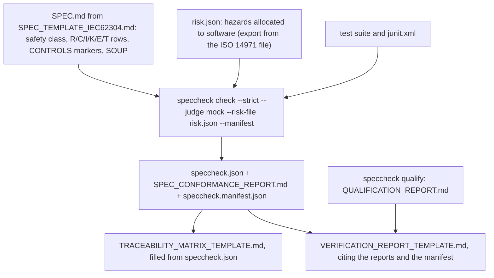

# Templates for regulated use (IEC 62304 / ISO 13485)

> **Applies to:** speccheck 1.26.0 (`docs/plans/ISO13485_READINESS_PLAN.md` §3.6).
> **Status:** starting points a manufacturer maps onto its own procedures. They are not a
> substitute for those procedures, and using them does not make a product conform to IEC 62304.
> Have them reviewed by your regulatory or quality function before first use.

| Template | IEC 62304 deliverable it maps onto | Filled from |
| --- | --- | --- |
| `SPEC_TEMPLATE_IEC62304.md` | Software requirements specification (5.2), with the software safety class (4.3), risk control requirements (5.2.3, 7.2), SOUP (5.3.3, 5.3.4, 7.1.2, 8.1.2) and the software system test plan (5.7.1) | written by the team; checked by `speccheck check` |
| `TRACEABILITY_MATRIX_TEMPLATE.md` | Traceability between system requirements, software requirements, risk control measures and tests (5.1.1, 5.7.4, 7.3.3) | `speccheck.json` and the risk file of one `check --manifest` run |
| `VERIFICATION_REPORT_TEMPLATE.md` | Software system test record and verification report (5.7.5, 5.8.1, 5.8.2) | the same run's reports and manifest, the tool's qualification record, the team's review |

## How the three fit together

*Figure — one release's records: the spec and risk file go in, one strict, manifest-bound run comes
out, and both reports cite it.*

## Rules that keep the records honest

- **One run is the evidence.** The traceability matrix and the verification report cite the same
  `check` run, identified by its manifest's `tree_sha256`. Re-run `speccheck verify` against that
  manifest before signing: it exits `1` if any file the run read has changed since.
- **Validated function only.** Verification evidence comes from `--judge none` or `--judge mock`
  (the intended use, `docs/validation/INTENDED_USE.md`). An `--judge llm` run may find weak tests,
  but its verdicts are advisory and are not cited as evidence.
- **The tool is qualified on the machine that ran it.** The verification report attaches the
  `speccheck qualify` record from that installation (`docs/validation/IQ_OQ_PROTOCOL.md`).
- **Hazards stay in the risk file.** A `VERIFIED` hazard means its software risk control measures
  passed their tests. Whether the residual risk is acceptable is decided in the ISO 14971 file, not
  by speccheck.

## Not built

speccheck has no software-safety-class feature: the class is a header for reviewers, and the
stricter class-C checks the readiness plan proposes (§3.3) are not implemented. For class B and C
software, run the gate with `--strict` and `--risk-file`, and write the class-specific activities
into your own plan.
