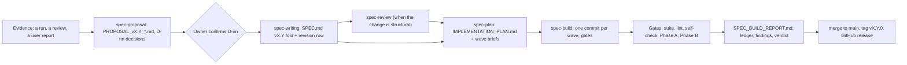

# Development process — how speccheck is specified, built, verified and released

> **Applies to:** speccheck from 1.26.0 (`docs/plans/ISO13485_READINESS_PLAN.md` §3.5).
> **Audience:** a manufacturer qualifying speccheck's supplier (ISO 13485:2016 clause 7.4, and
> 4.1.6 for the software's validation), and anyone changing speccheck.
> **Status:** describes the process as it is practised, with its records, and names the gaps
> (§10). speccheck is not medical-device software and is not developed under ISO 13485 or
> IEC 62304. §2 maps its activities onto IEC 62304's only so a reviewer can find the evidence they
> expect, not to claim conformance.

## 1. Principles

- **The specification is the source of truth.** `SPEC.md` declares every requirement (R),
  contract (C), invariant (I), constraint (K), edge case (E) and acceptance test (T) by id. Code
  that no id asks for is not written; an id that no code and test realizes fails the build gate.
- **Nothing grades its own work.** The tool checks its own build (self-application), every
  decision taken on the owner's behalf is recorded for the owner to confirm, and the LLM judge can
  only lower a status, never raise one.
- **Every change leaves a record.** A proposal, a spec revision row, a plan, one commit per wave,
  a build report with the gate output — each in the repository, under version control.

## 2. Lifecycle



*Figure 1 — one spec version, from evidence to release. Each box names the record it leaves.*

| Activity (IEC 62304 clause, for orientation) | What speccheck does | Record |
| --- | --- | --- |
| Development planning (5.1) | `spec-plan` writes a wave plan per version: the order, each wave's gate commands, a size budget with its anchors, the one fork the owner settles | `docs/plans/IMPLEMENTATION_PLAN.md`, `DETAILED_IMPLEMENTATION_PLAN_W<n>.md` (rewritten per version; history in git) |
| Requirements analysis (5.2) | `spec-proposal` argues a change from evidence and drafts its rows; `spec-writing` folds the confirmed rows into `SPEC.md` | `docs/proposals/PROPOSAL_v*.md`; `SPEC.md` §2–§9 and its revision history; §12 decisions with owner and status |
| Architectural design (5.3) | module layout, dependency direction, data flow | `ARCHITECTURE.md` |
| Detailed design (5.4) | the §4 contracts pin every interface and data shape | `SPEC.md` §4 (C-nn) |
| Implementation and unit verification (5.5) | test-first per §9 row, one wave at a time | commits `feat(...)`, the §9 suite under `tests/` |
| Integration and system testing (5.6, 5.7) | the full suite, the golden fixtures, the self-check, and the two-phase speccheck gate | `junit.xml` (per run), `SPEC_BUILD_REPORT.md` §0x gate block |
| Release (5.8) | merge, tag, GitHub release with notes, tree hash and Validation impact | git tags, GitHub releases, `docs/validation/CHANGE_CONTROL.md` |
| Maintenance, problem resolution (6, 9) | findings (F-nnn) and known anomalies (KA-nn) | `SPEC_BUILD_REPORT.md`, `fix(spec)` commits, `src/speccheck/_qualify/known_anomalies.json` |
| Configuration management (8) | git, branch per version, pinned dependencies | git history, `uv.lock`, `pyproject.toml` |

## 3. Roles

| Role | Who | Responsibility |
| --- | --- | --- |
| Owner | the maintainer (one person) | confirms or rejects every D-nn decision; approves merges to `main`, tags and releases; owns the risk assessment's severities |
| Agents | AI coding agents running the repository's skills (`skills/`) | draft proposals, spec folds, plans, code and tests; run the gates; write the build report. Every commit an agent co-wrote carries a `Co-Authored-By:` trailer naming the model |
| Judge | the LLM judge in Phase B | finds tests that execute an id without asserting it; can only downgrade |

An agent never confirms a decision: a default it takes is written into `SPEC.md` §12 as `confirm`
and stays so until the owner settles it. An agent never merges, tags, pushes or publishes without
the owner asking for it.

## 4. Changing the specification

1. **Evidence first.** A proposal starts from a reproducible artifact — a run's output, a review
   finding, a user's report — with figures exact enough to recheck (`spec-proposal` skill).
2. **Proposal.** Six fixed sections: problem, change (with draft rows in the spec's own normative
   language), cost, alternatives, decisions, what it does not do. Fresh ids only; ids are never
   renumbered or reused (a retired id is struck through and stays).
3. **Decision.** The owner confirms each D-nn on its recommended or alternative branch. The
   proposal's status line records the date.
4. **Fold.** `spec-writing` turns the confirmed rows into `SPEC.md`, bumps its version, and adds a
   revision-history row naming the proposal and every interpretation settled while folding. The
   §12 *Affects* column lists every id a decision touches; it is machine-read by `speccheck
   impact`.
5. **Review.** A structural change (a new contract family, a changed status rule) gets a
   `spec-review` pass before building; its findings (F-nnn) are folded before the plan is written.

## 5. Building and verifying

One branch per spec version (`spec/vX.Y`). Phase 0 writes the plan; each wave is built test-first
and committed with its gate result before the next wave starts. The gate a version must pass before
it is merged, run on a fresh test run:

```bash
uv run python -m pytest tests -q --junitxml=junit.xml           # the §9 suite: 0 failed
uv run ruff check src tests tools                                # lint: clean
uv run speccheck --self-check                                    # packaged golden fixture
uv run python tools/sync_selfcheck.py --check                    # _selfcheck/ equals fixtures/target/
uv run speccheck check --spec SPEC.md --src src --tests tests --results junit.xml \
    --judge mock --strict --risk-file src/speccheck/_qualify/tool_risk.json --out build/speccheck
                                                                 # Phase A: CONFORMING, hazards 10/10 verified
uv run speccheck check ... --judge llm --strict --risk-file src/speccheck/_qualify/tool_risk.json \
    --judge-concurrency 16 --out build/speccheck-llm             # Phase B: CONFORMING, unknown_rate <= 0.2
```

- **Every id realized.** `--strict` exits 0 only when every in-scope id is `PASSING`, no citation
  is dangling or stale, and no tool hazard is `UNCONTROLLED` (the tool's own risk assessment is a
  risk file its build checks; `TOOL_RISK_ASSESSMENT.md`).
- **Phase B is evidence only when the endpoint answered.** One probe request precedes the full
  run; a run blocked by the provider (HTTP 401, 402) is recorded as not run, never as a pass.
- **Every Note read.** The build report lists the Notes of both final runs and says which are
  expected.
- **Goldens are guarded, not trusted.** A golden produced by the code it checks is a regression
  guard; the build report names the independent oracle each conformance claim rests on (the
  hand-verified §9.8 fixture, a hand check against a contract, a formal model).
- **Formal model.** `proof/` (Lean 4) proves the model of the status algorithm, the exit map and
  the judge's downgrade-only rule for all inputs; `proof_from_spec/` models the spec's own claims.
  The model is transcribed by hand from the code; its version is stated in its README.

## 6. Defects

| Where found | What happens | Record |
| --- | --- | --- |
| In the spec, during a build (a contradiction, an untestable clause) | a finding F-nnn; `fix(spec):` commit with the smallest correct change; the revision row says what was found | `SPEC_BUILD_REPORT.md` "What the build found"; the commit |
| In the code, during a build | a failing test first, then the fix, in the wave that owns the code | the wave's commit |
| By a review | F-nnn findings with severity and a remediation plan; P0/P1 folded before building | `docs/reviews/` |
| After release | a regression test and a fix in the next version; a defect that cannot be fixed now becomes a known anomaly with its workaround | `known_anomalies.json` (KA-nn, append-only, `fixed_in` set when fixed) |

A test is never edited to make a real failure pass; if the test was wrong, the commit says which
and why.

## 7. Configuration management

- **Version control:** git, one repository (`github.com/rioffe/speccheck`); `main` holds released
  versions only; work happens on `spec/vX.Y` branches, merged fast-forward and then deleted.
- **Commit types:** `docs(spec)` (a fold), `fix(spec)` (a found defect in the spec), `feat(...)`
  (a wave), `docs(build)` (the build report and gates), `docs(plans)`, `fix(...)`, `test(...)`,
  `chore(...)`. A wave's commit body names its ids and its gate result.
- **Versions:** `X.Y.Z` where `X.Y` is the `SPEC.md` version the code implements; a patch release
  changes no spec row. `__version__`, the README and the build report's title are bound to the
  spec version by a test.
- **Dependencies:** the validated function uses the Python standard library only; the optional
  extras (`llm`, `dev`) are pinned in `uv.lock`; Python 3.12; the Lean toolchain is pinned in
  `proof/lean-toolchain`.
- **What a release is:** the tag. Its `package_tree_sha256` (published in the release notes)
  identifies an installation exactly (`IQ_OQ_PROTOCOL.md`).

## 8. Release

1. The build report's verdict is PASS (both gates conforming) or every exception is a named,
   owner-approved deferral.
2. The owner asks for the merge; `spec/vX.Y` is fast-forwarded into `main` and pushed.
3. `SPEC.pdf` is regenerated (`spec2pdf.sh SPEC.md`) and committed.
4. An annotated tag `vX.Y.0` is created and pushed.
5. A GitHub release is published with: the two gate summary lines and the judge model and
   `unknown_rate`; what changed; *Not yet*; upgrading notes; the `package_tree_sha256`; and the
   *Validation impact* section from `tools/validation_impact.py <previous tag>`
   (`CHANGE_CONTROL.md`).

## 9. Records index

| Record | Path |
| --- | --- |
| Specification and its revision history | `SPEC.md`, `SPEC.pdf` |
| Proposals and decisions | `docs/proposals/`, `SPEC.md` §12 |
| Reviews and formal-model findings | `docs/reviews/` |
| Plans | `docs/plans/` |
| Architecture | `ARCHITECTURE.md` |
| Build evidence, findings, verdicts per version | `SPEC_BUILD_REPORT.md` |
| Validation pack | `docs/validation/` |
| Releases | git tags; GitHub releases |
| Known anomalies | `src/speccheck/_qualify/known_anomalies.json` |

## 10. Known gaps in this process

Stated so a supplier assessment can weigh them; each has the action that would close it.

| Gap | Consequence | Action |
| --- | --- | --- |
| No continuous integration: every gate runs on the developer's machine | the record of a gate is the build report's pasted output, not an independent run | add a CI workflow that runs the §5 gate (Phase A) on every push and attaches `junit.xml` and the reports |
| One human; agents draft most of the work | no second human reviews a change before merge; independence rests on the gates and on the owner confirming decisions | name an independent reviewer for releases a customer will validate; record the review in the release notes |
| Spec review is not run for every version (last full review: the v1.23 fold) | a precision defect can reach a build; v1.25 and v1.26 each found one or two while building (F-801, F-901, F-902) | run `spec-review` before building any version that adds a contract |
| Versions 1.19, 1.21, 1.22 and 1.23.0 were built but never tagged or released | those versions cannot be identified by a tag or qualified | from 1.26.0 every version is tagged and released (`CHANGE_CONTROL.md`) |
| The formal model is transcribed by hand and models v1.18 | proofs cover the model, not the code, and not the v1.25 exit condition (KA-04) | re-run `spec-proof` against the current version |
| No signed releases | a release is identified by its tag and tree hash, not a signature | sign tags or wheels when key custody exists |
